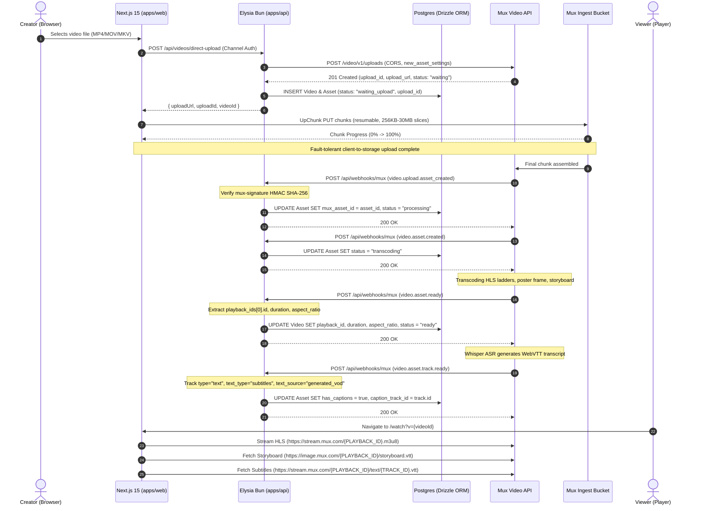

# Mux Video Pipeline: Direct Upload, Webhook Lifecycle, and Player Delivery Specification

**Destination Document**: Technical Architecture & Contract Specification for YouTube Clone Video Ingestion  
**Target Monorepo**: Bun Workspaces (`apps/web` Next.js 15, `apps/api` Elysia Bun Backend)  
**Domain Vocabulary**: Strictly aligned with `GLOSSARY.md` (`User`, `Channel`, `Asset`, `Video`, `Playback ID`, `Visibility`, `Storyboard`)  

---

## 1. Architecture Overview & End-to-End Pipeline

Video ingestion in the platform employs a **direct client-to-storage architecture**. High-definition video files are uploaded directly from the browser to Mux's ingest infrastructure via resumable, chunked `PUT` requests, completely bypassing the application backend (`apps/api`). The Elysia Bun backend acts strictly as an orchestrator: generating presigned upload URLs, authenticating Channel permissions, verifying cryptographic webhook signatures, and updating relational state in PostgreSQL via Drizzle ORM.

### 1.1 Complete Lifecycle Sequence Diagram



---

## 2. Direct Upload API Contract (`POST /video/v1/uploads`)

Direct uploads allow authenticated clients to push raw video files straight to Mux storage without touching application application servers.

### 2.1 Backend Request: Creating a Direct Upload

When a Creator initiates an upload in the YouTube Studio UI, the Elysia backend makes an authenticated `POST` request to the Mux Video API.

* **HTTP Method**: `POST`
* **URL**: `https://api.mux.com/video/v1/uploads`
* **Authentication**: HTTP Basic Auth with `MUX_TOKEN_ID` as the username and `MUX_TOKEN_SECRET` as the password
* **Headers**: `Content-Type: application/json`

#### Request Payload Specification

```json
{
  "cors_origin": "*",
  "timeout": 3600,
  "new_asset_settings": {
    "playback_policies": [
      "public"
    ],
    "video_quality": "basic",
    "inputs": [
      {
        "generated_subtitles": [
          {
            "language_code": "en",
            "name": "English CC"
          }
        ]
      }
    ],
    "passthrough": "video_vid_01h8xz9k4m2qrpst"
  }
}
```

#### Field-by-Field Breakdown

| Field | Type | Required | Description |
| :--- | :--- | :--- | :--- |
| `cors_origin` | `string` | **Yes** | The origin allowed to upload via CORS. In development, `"*"` can be used. In production, restrict to the web domain (e.g., `https://youtube.clone.com` or `https://*.youtube.clone.com`). |
| `timeout` | `integer` | No | Validity duration of the upload URL in seconds (default: `3600`, min: `60`, max: `604800` [7 days]). If the upload does not complete before timeout, the upload transitions to `timed_out`. |
| `new_asset_settings` | `object` | No | Settings applied automatically to the resulting `Asset` once chunk ingest completes. |
| `new_asset_settings.playback_policies` | `string[]` | No | Array of playback policy access tiers. Options: `["public"]` (unrestricted playback via Playback ID) or `["signed"]` (requires signed JWT token). Defaults to `["public"]`. *(Note: legacy API accepts `playback_policy: ["public"]`).* |
| `new_asset_settings.video_quality` | `string` | No | Encoding tier: `"basic"` (cost-effective standard encoding, up to 1080p), `"plus"` (higher bitrate encoding), or `"premium"` (maximum visual fidelity). |
| `new_asset_settings.inputs` | `object[]` | No | Array of input configurations. For direct uploads, `inputs[0]` omits `url` (since source media arrives via direct upload) and contains nested `generated_subtitles`. |
| `new_asset_settings.inputs[0].generated_subtitles` | `object[]` | No | Configuration for Whisper ASR auto-generated captions. |
| `new_asset_settings.inputs[0].generated_subtitles[].language_code` | `string` | **Yes** | BCP 47 compliant language code (e.g., `"en"`, `"es"`, `"fr"`, or `"auto"` for automatic detection). |
| `new_asset_settings.inputs[0].generated_subtitles[].name` | `string` | **Yes** | Human-readable label displayed in player caption pickers (e.g., `"English CC"`, `"Spanish"`). |
| `new_asset_settings.passthrough` | `string` | No | Arbitrary string (max 255 chars) passed through to all associated webhooks. Recommended: internal database `video_id`. |
| `new_asset_settings.normalize_audio` | `boolean` | No | Normalizes audio loudness to standard broadcast levels (-24 LKFS/LUFS). Recommended: `true`. |
| `new_asset_settings.max_resolution_tier` | `string` | No | Cap on resolution encoding: `"1080p"` (default), `"1440p"`, or `"2160p"` (4K). |

### 2.2 API Response Specification

Upon successful creation, Mux responds with `HTTP 201 Created`:

```json
{
  "data": {
    "id": "c3Jj0211a4vN3QcQ7gXF3xJ8vV119",
    "url": "https://storage.googleapis.com/video-storage-us-east1-uploads/c3Jj0211a4vN3QcQ7gXF3xJ8vV119?Expires=1728770400&GoogleAccessId=mux-direct-upload%40mux-cloud.iam.gserviceaccount.com&Signature=...",
    "asset_id": null,
    "status": "waiting",
    "timeout": 3600,
    "cors_origin": "*",
    "new_asset_settings": {
      "playback_policies": [
        "public"
      ],
      "video_quality": "basic",
      "inputs": [
        {
          "generated_subtitles": [
            {
              "language_code": "en",
              "name": "English CC"
            }
          ]
        }
      ],
      "passthrough": "video_vid_01h8xz9k4m2qrpst"
    }
  }
}
```

#### Upload Status State Machine

* `waiting`: The upload URL is active and awaiting client upload.
* `asset_created`: The client has finished uploading all chunks; Mux has verified the file container and created an Asset ID.
* `errored`: The upload failed (e.g., non-video container uploaded or corrupted chunks).
* `cancelled`: The upload was cancelled programmatically before completion via `PUT /video/v1/uploads/{UPLOAD_ID}/cancel`.
* `timed_out`: The upload URL expired without completion.

### 2.3 Server-Side Implementation using `@mux/mux-node`

```typescript
// apps/api/src/services/mux.service.ts
import Mux from '@mux/mux-node';

export const mux = new Mux({
  tokenId: process.env.MUX_TOKEN_ID!,
  tokenSecret: process.env.MUX_TOKEN_SECRET!,
});

export interface CreateDirectUploadParams {
  videoId: string;
  corsOrigin?: string;
  languageCode?: string;
}

export async function createDirectVideoUpload({
  videoId,
  corsOrigin = process.env.WEB_APP_URL || '*',
  languageCode = 'en',
}: CreateDirectUploadParams) {
  const upload = await mux.video.uploads.create({
    cors_origin: corsOrigin,
    timeout: 3600, // 1 hour
    new_asset_settings: {
      playback_policies: ['public'],
      video_quality: 'basic',
      normalize_audio: true,
      passthrough: videoId,
      inputs: [
        {
          generated_subtitles: [
            {
              language_code: languageCode,
              name: languageCode === 'en' ? 'English CC' : `Subtitles (${languageCode})`,
            },
          ],
        },
      ],
    },
  });

  return {
    uploadId: upload.id,
    uploadUrl: upload.url,
    status: upload.status,
  };
}
```

---

## 3. Webhook Event Lifecycle & Sequencing

Mux handles video transcoding, HLS packaging, storyboard generation, and AI speech recognition asynchronously. The backend tracks state via four primary webhooks in strict chronological sequence.

### 3.1 Event Delivery Sequencing

| Sequence | Event Type | Trigger Condition | Target Resource | Key Action for YouTube Clone |
| :---: | :--- | :--- | :--- | :--- |
| **1** | `video.upload.asset_created` | Final chunk uploaded by client to Google Cloud Storage. Mux registers new Asset entity. | `upload` (`c3Jj...`) | Link `mux_asset_id` to database `Video` record; update upload progress to "Processing". |
| **2** | `video.asset.created` | Mux media pipeline initializes transcoding worker. | `asset` (`0201p...`) | Update asset status to `preparing`. |
| **3** | `video.asset.ready` | Transcoding finished. HLS manifest, MP4 renditions, and storyboard sprites generated. | `asset` (`0201p...`) | Extract `playback_ids[0].id`, `duration`, `aspect_ratio`, `resolution_tier`. Set Video status to `ready`. Video becomes playable. |
| **4** | `video.asset.track.ready` | OpenAI Whisper ASR finishes speech recognition. WebVTT subtitle track ready. | `track` (`text_track_...`) | Store `caption_track_id`, update `has_captions = true`. Enable Closed Caption button in player. |

---

### 3.2 Webhook Payloads & Field Schemas

#### Event 1: `video.upload.asset_created`

Fired when the client finishes uploading to the GCS bucket. Indicates that the upload has succeeded and links the Upload ID to the new Asset ID.

```json
{
  "type": "video.upload.asset_created",
  "id": "evt_01h8xza22n8q47k8w9j3000001",
  "created_at": "2026-10-12T20:30:00.000Z",
  "environment": {
    "name": "Production",
    "id": "env_prod_01"
  },
  "object": {
    "type": "upload",
    "id": "c3Jj0211a4vN3QcQ7gXF3xJ8vV119"
  },
  "data": {
    "id": "c3Jj0211a4vN3QcQ7gXF3xJ8vV119",
    "asset_id": "0201p02fGKPE7MrbC269XRD7LpcHhrmbu0002",
    "status": "asset_created",
    "timeout": 3600,
    "cors_origin": "*",
    "new_asset_settings": {
      "playback_policies": ["public"],
      "video_quality": "basic",
      "passthrough": "video_vid_01h8xz9k4m2qrpst"
    }
  }
}
```

* **Key fields**: `data.id` (Upload ID), `data.asset_id` (Asset ID created), `data.new_asset_settings.passthrough` (Internal Video ID).

---

#### Event 2: `video.asset.created`

Fired when the asset enters the ingestion pipeline.

```json
{
  "type": "video.asset.created",
  "id": "evt_01h8xza22n8q47k8w9j3000002",
  "created_at": "2026-10-12T20:30:02.000Z",
  "object": {
    "type": "asset",
    "id": "0201p02fGKPE7MrbC269XRD7LpcHhrmbu0002"
  },
  "data": {
    "id": "0201p02fGKPE7MrbC269XRD7LpcHhrmbu0002",
    "upload_id": "c3Jj0211a4vN3QcQ7gXF3xJ8vV119",
    "status": "preparing",
    "video_quality": "basic",
    "passthrough": "video_vid_01h8xz9k4m2qrpst",
    "created_at": "1728770402"
  }
}
```

---

#### Event 3: `video.asset.ready`

Fired when video transcoding, audio normalization, and HLS manifest generation are completely finished. The video can now be played anywhere using its Playback ID.

```json
{
  "type": "video.asset.ready",
  "id": "evt_01h8xza22n8q47k8w9j3000003",
  "created_at": "2026-10-12T20:31:15.000Z",
  "object": {
    "type": "asset",
    "id": "0201p02fGKPE7MrbC269XRD7LpcHhrmbu0002"
  },
  "data": {
    "id": "0201p02fGKPE7MrbC269XRD7LpcHhrmbu0002",
    "upload_id": "c3Jj0211a4vN3QcQ7gXF3xJ8vV119",
    "status": "ready",
    "duration": 482.518,
    "aspect_ratio": "16:9",
    "resolution_tier": "1080p",
    "max_stored_resolution": "HD",
    "max_stored_frame_rate": 60.0,
    "video_quality": "basic",
    "passthrough": "video_vid_01h8xz9k4m2qrpst",
    "playback_ids": [
      {
        "id": "3A3qZ4bKmR00xP2yF4yN3lZ",
        "policy": "public"
      }
    ],
    "tracks": [
      {
        "id": "trk_vid_01h8xza990",
        "type": "video",
        "duration": 482.518,
        "max_width": 1920,
        "max_height": 1080,
        "max_frame_rate": 60.0
      },
      {
        "id": "trk_aud_01h8xza991",
        "type": "audio",
        "duration": 482.518,
        "max_channels": 2,
        "max_channel_layout": "stereo"
      },
      {
        "id": "trk_txt_01h8xza992",
        "type": "text",
        "text_type": "subtitles",
        "text_source": "generated_vod",
        "language_code": "en",
        "name": "English CC",
        "status": "preparing"
      }
    ]
  }
}
```

* **Critical Payload Fields for Database Storage**:
  * `data.playback_ids[0].id`: The public streaming token (`Playback ID`).
  * `data.duration`: Duration in seconds (`float64`).
  * `data.aspect_ratio`: String representation (`"16:9"`, `"4:3"`, `"9:16"`).
  * `data.resolution_tier`: Quality tier (`"720p"`, `"1080p"`, `"1440p"`, `"2160p"`).
  * `data.tracks`: Array containing video, audio, and preparing text tracks.

---

#### Event 4: `video.asset.track.ready`

Auto-captioning using OpenAI Whisper runs asynchronously after video encoding so initial playback is never delayed. This event fires when speech recognition finishes and the WebVTT file is attached to the HLS manifest.

```json
{
  "type": "video.asset.track.ready",
  "id": "evt_01h8xza22n8q47k8w9j3000004",
  "created_at": "2026-10-12T20:31:45.000Z",
  "object": {
    "type": "asset",
    "id": "0201p02fGKPE7MrbC269XRD7LpcHhrmbu0002"
  },
  "data": {
    "id": "trk_txt_01h8xza992",
    "asset_id": "0201p02fGKPE7MrbC269XRD7LpcHhrmbu0002",
    "type": "text",
    "text_type": "subtitles",
    "text_source": "generated_vod",
    "language_code": "en",
    "name": "English CC",
    "status": "ready",
    "closed_captions": false
  }
}
```

* **Key fields**:
  * `data.asset_id`: Parent Asset ID.
  * `data.id`: Track ID used to directly download captions or plain text transcripts (`https://stream.mux.com/{PLAYBACK_ID}/text/{TRACK_ID}.txt`).
  * `data.status`: Must equal `"ready"`.
  * `data.text_source`: `"generated_vod"` distinguishes ASR subtitles from uploaded (`"uploaded"`) or embedded (`"embedded"`) subtitle tracks.

---

## 4. Elysia Bun Webhook Signature Verification

### 4.1 Cryptographic Specification & Header Structure

Every HTTP POST request from Mux contains the `mux-signature` header:

```http
Mux-Signature: t=1728770400,v1=20c75c1180c701ee8a796e81507cfd5c932fc17cf63a4a55566fd38da3a2d3d2
```

The header contains comma-separated key-value pairs:
1. `t`: Unix epoch timestamp (seconds) when Mux dispatched the webhook.
2. `v1`: Hex-encoded HMAC-SHA256 signature generated over the signed payload. Multiple `v1` signatures may be present during secret rotation.

#### The Signed Payload

The exact string signed by Mux is:

$$\text{payload} = \text{timestamp} + \text{"."} + \text{rawRequestBody}$$

Where `timestamp` is the exact string value of `t` from the header, followed by a literal period `.`, followed by the exact verbatim byte string of the HTTP request body.

#### Security Requirements:
1. **Timestamp Freshness**: Compute $| \text{currentTime} - \text{timestamp} |$. If the difference exceeds $300$ seconds (5 minutes), reject the request as expired to defend against replay attacks.
2. **Timing-Safe Equality**: String comparison (`===`) leaks timing information that enables byte-by-byte signature forgery. Use `crypto.timingSafeEqual`.
3. **Buffer Length Guards**: In Node and Bun, `timingSafeEqual(bufA, bufB)` throws a fatal `RangeError` if `bufA.length !== bufB.length`. Pre-validate that buffer lengths match before comparison.
4. **Raw Body Preservation**: Body parsers that parse JSON into a JavaScript object destroy original formatting (whitespace, key ordering, unicode escapes). The signature **MUST** be verified against the raw unparsed string.

---

### 4.2 Raw Body Ingestion in Elysia

By default, Elysia parses `application/json` bodies into plain JavaScript objects before route handler invocation. To access the exact raw string in Elysia on Bun, configure the route with `parse: 'text'`. This guarantees that `body` remains a verbatim `string`, allowing cryptographic validation prior to calling `JSON.parse()`.

---

### 4.3 Complete Elysia Route Handler Code

```typescript
// apps/api/src/routes/webhooks/mux.ts
import { Elysia, t } from 'elysia';
import { createHmac, timingSafeEqual } from 'node:crypto';
import { db } from '../../db';
import { videos, assets } from '../../db/schema';
import { eq } from 'drizzle-orm';

// ---------------------------------------------------------------------------
// 1. Signature Verification Helper
// ---------------------------------------------------------------------------

export interface MuxSignatureVerificationResult {
  isValid: boolean;
  error?: string;
}

/**
 * Validates Mux-Signature header against the raw request body.
 * Implements constant-time HMAC-SHA256 comparison and 5-minute replay tolerance.
 */
export function verifyMuxSignature(
  rawBody: string,
  signatureHeader: string | null | undefined,
  secret: string,
  toleranceSeconds = 300 // 5 minutes
): MuxSignatureVerificationResult {
  if (!signatureHeader) {
    return { isValid: false, error: 'Missing Mux-Signature header' };
  }
  if (!secret) {
    return { isValid: false, error: 'Webhook secret is not configured' };
  }

  // Parse header: t=1728770400,v1=abc123...,v1=def456...
  const pairs = signatureHeader.split(',');
  let timestamp: string | null = null;
  const signatures: string[] = [];

  for (const pair of pairs) {
    const [key, value] = pair.trim().split('=');
    if (key === 't' && value) {
      timestamp = value;
    } else if (key === 'v1' && value) {
      signatures.push(value);
    }
  }

  if (!timestamp) {
    return { isValid: false, error: 'Missing timestamp (t) in Mux-Signature' };
  }
  if (signatures.length === 0) {
    return { isValid: false, error: 'Missing signature (v1) in Mux-Signature' };
  }

  // Check timestamp tolerance
  const numericTimestamp = parseInt(timestamp, 10);
  if (Number.isNaN(numericTimestamp)) {
    return { isValid: false, error: 'Invalid numeric timestamp in Mux-Signature' };
  }

  const currentTimestamp = Math.floor(Date.now() / 1000);
  if (Math.abs(currentTimestamp - numericTimestamp) > toleranceSeconds) {
    return { isValid: false, error: 'Webhook signature timestamp outside tolerance window' };
  }

  // Construct signed payload: ${timestamp}.${rawBody}
  const signedPayload = `${timestamp}.${rawBody}`;
  const computedHashHex = createHmac('sha256', secret)
    .update(signedPayload)
    .digest('hex');

  const computedBuffer = Buffer.from(computedHashHex, 'utf8');

  // Verify against all v1 signatures (supports secret rotation)
  let signatureMatch = false;
  for (const sig of signatures) {
    const sigBuffer = Buffer.from(sig, 'utf8');
    if (sigBuffer.length === computedBuffer.length) {
      if (timingSafeEqual(sigBuffer, computedBuffer)) {
        signatureMatch = true;
        break;
      }
    }
  }

  if (!signatureMatch) {
    return { isValid: false, error: 'Invalid HMAC-SHA256 signature' };
  }

  return { isValid: true };
}

// ---------------------------------------------------------------------------
// 2. Webhook Event Types
// ---------------------------------------------------------------------------

export interface MuxBaseEvent<T = any> {
  type: string;
  id: string;
  created_at: string;
  object: {
    type: 'upload' | 'asset' | 'track' | 'live_stream';
    id: string;
  };
  data: T;
}

export interface MuxUploadAssetCreatedData {
  id: string;
  asset_id: string;
  status: string;
  new_asset_settings?: {
    passthrough?: string;
  };
}

export interface MuxAssetReadyData {
  id: string;
  upload_id?: string;
  status: 'ready';
  duration: number;
  aspect_ratio: string;
  resolution_tier: '720p' | '1080p' | '1440p' | '2160p';
  passthrough?: string;
  playback_ids: Array<{
    id: string;
    policy: 'public' | 'signed';
  }>;
  tracks: Array<{
    id: string;
    type: 'video' | 'audio' | 'text';
    text_type?: 'subtitles' | 'chapters';
    text_source?: 'generated_vod' | 'uploaded' | 'embedded';
    language_code?: string;
    name?: string;
    status?: 'preparing' | 'ready';
  }>;
}

export interface MuxAssetTrackReadyData {
  id: string;
  asset_id: string;
  type: 'text';
  text_type: 'subtitles';
  text_source: 'generated_vod' | 'uploaded' | 'embedded';
  language_code: string;
  name: string;
  status: 'ready';
}

// ---------------------------------------------------------------------------
// 3. Elysia Route Controller
// ---------------------------------------------------------------------------

export const muxWebhookRoutes = new Elysia({ prefix: '/api/webhooks' })
  .post(
    '/mux',
    async ({ body, headers, set }) => {
      const webhookSecret = process.env.MUX_WEBHOOK_SECRET;
      if (!webhookSecret) {
        console.error('[MuxWebhook] MUX_WEBHOOK_SECRET is not configured');
        set.status = 500;
        return { error: 'Server webhook misconfiguration' };
      }

      // rawBody is guaranteed to be string because parse: 'text' is configured
      const rawBody = body;
      const signatureHeader = headers['mux-signature'];

      const verification = verifyMuxSignature(rawBody, signatureHeader, webhookSecret);
      if (!verification.isValid) {
        console.warn(`[MuxWebhook] Signature rejected: ${verification.error}`);
        set.status = 401;
        return { error: verification.error };
      }

      // Parse verified raw payload
      let event: MuxBaseEvent;
      try {
        event = JSON.parse(rawBody);
      } catch (err) {
        set.status = 400;
        return { error: 'Invalid JSON payload' };
      }

      console.log(`[MuxWebhook] Processing event: ${event.type} (ID: ${event.id})`);

      try {
        switch (event.type) {
          // -----------------------------------------------------------------
          // 1. Direct Upload Completed -> Link Asset ID
          // -----------------------------------------------------------------
          case 'video.upload.asset_created': {
            const data = event.data as MuxUploadAssetCreatedData;
            const uploadId = data.id;
            const assetId = data.asset_id;
            const videoId = data.new_asset_settings?.passthrough;

            console.log(`[MuxWebhook] Upload ${uploadId} -> Asset ${assetId} (Video: ${videoId})`);

            // Update Asset record with mux_asset_id and status 'processing'
            if (videoId) {
              await db
                .update(assets)
                .set({
                  muxAssetId: assetId,
                  status: 'processing',
                  updatedAt: new Date(),
                })
                .where(eq(assets.videoId, videoId));
            } else {
              await db
                .update(assets)
                .set({
                  muxAssetId: assetId,
                  status: 'processing',
                  updatedAt: new Date(),
                })
                .where(eq(assets.muxUploadId, uploadId));
            }
            break;
          }

          // -----------------------------------------------------------------
          // 2. Asset Transcoding Ready -> Playback ID & Dimensions Available
          // -----------------------------------------------------------------
          case 'video.asset.ready': {
            const data = event.data as MuxAssetReadyData;
            const assetId = data.id;
            const publicPlayback = data.playback_ids?.find((p) => p.policy === 'public');
            const playbackId = publicPlayback ? publicPlayback.id : data.playback_ids?.[0]?.id;

            if (!playbackId) {
              console.error(`[MuxWebhook] Asset ${assetId} ready but missing Playback ID`);
              break;
            }

            console.log(`[MuxWebhook] Asset ${assetId} READY. Playback ID: ${playbackId}`);

            // Update relational asset and video records
            await db.transaction(async (tx) => {
              // 1. Update Asset
              await tx
                .update(assets)
                .set({
                  muxPlaybackId: playbackId,
                  status: 'ready',
                  duration: data.duration,
                  aspectRatio: data.aspect_ratio,
                  resolutionTier: data.resolution_tier,
                  updatedAt: new Date(),
                })
                .where(eq(assets.muxAssetId, assetId));

              // 2. Find video associated with this asset
              const [assetRecord] = await tx
                .select({ videoId: assets.videoId })
                .from(assets)
                .where(eq(assets.muxAssetId, assetId))
                .limit(1);

              if (assetRecord?.videoId) {
                // Update Video record to ready for playback
                await tx
                  .update(videos)
                  .set({
                    playbackId: playbackId,
                    duration: Math.round(data.duration),
                    status: 'ready',
                    updatedAt: new Date(),
                  })
                  .where(eq(videos.id, assetRecord.videoId));
              }
            });
            break;
          }

          // -----------------------------------------------------------------
          // 3. Caption Track Ready -> Whisper ASR Complete
          // -----------------------------------------------------------------
          case 'video.asset.track.ready': {
            const data = event.data as MuxAssetTrackReadyData;
            if (data.type === 'text' && data.text_type === 'subtitles') {
              console.log(`[MuxWebhook] Subtitle track ready: ${data.id} for asset: ${data.asset_id}`);

              await db
                .update(assets)
                .set({
                  hasCaptions: true,
                  captionTrackId: data.id,
                  captionLanguage: data.language_code,
                  updatedAt: new Date(),
                })
                .where(eq(assets.muxAssetId, data.asset_id));
            }
            break;
          }

          // -----------------------------------------------------------------
          // 4. Failure States
          // -----------------------------------------------------------------
          case 'video.asset.errored':
          case 'video.upload.errored': {
            const uploadOrAssetId = event.data?.id;
            console.error(`[MuxWebhook] Processing failed for: ${uploadOrAssetId}`, event.data?.errors);

            await db
              .update(assets)
              .set({
                status: 'errored',
                errorMessage: JSON.stringify(event.data?.errors || 'Mux encoding error'),
                updatedAt: new Date(),
              })
              .where(
                event.type === 'video.upload.errored'
                  ? eq(assets.muxUploadId, uploadOrAssetId)
                  : eq(assets.muxAssetId, uploadOrAssetId)
              );
            break;
          }

          default:
            // Unhandled events (e.g. video.asset.created, video.asset.updated)
            break;
        }

        set.status = 200;
        return { received: true };
      } catch (handlerError) {
        console.error('[MuxWebhook] Error executing database transition:', handlerError);
        // Respond 500 so Mux retries with exponential backoff
        set.status = 500;
        return { error: 'Internal processing error' };
      }
    },
    {
      // CRITICAL: Tells Elysia to bypass JSON parsing and retain the raw text string.
      parse: 'text',
      headers: t.Object({
        'mux-signature': t.String(),
      }),
    }
  );
```

---

## 5. Player Assets & Delivery URL Architecture

All media delivery in the platform is powered by Mux's edge network using the public `Playback ID`.

```
                    ┌────────────────────────────┐
                    │  Mux Public Playback ID   │
                    │   {PLAYBACK_ID}            │
                    └─────────────┬──────────────┘
                                  │
         ┌────────────────────────┼────────────────────────┐
         │                        │                        │
         ▼                        ▼                        ▼
 ┌───────────────┐       ┌─────────────────┐      ┌─────────────────┐
 │ HLS Streaming │       │   Thumbnails    │      │   Storyboards   │
 │ Manifest      │       │   & Posters     │      │   & Scrubbing   │
 └───────┬───────┘       └────────┬────────┘      └────────┬────────┘
         │                        │                        │
         ▼                        ▼                        ▼
 stream.mux.com           image.mux.com            image.mux.com
 /{PLAYBACK_ID}.m3u8      /{PLAYBACK_ID}           /{PLAYBACK_ID}
                          /thumbnail.jpg           /storyboard.vtt
```

### 5.1 HLS Streaming Manifest

* **Manifest URL**: `https://stream.mux.com/{PLAYBACK_ID}.m3u8`
* **Protocol**: HTTP Live Streaming (HLS v7 with fragmented MP4 / TS segments).
* **Adaptive Bitrate (ABR)**: Automatically serves multi-bitrate representations (e.g., 1080p60, 720p60, 480p, 360p, 240p, 144p) matched to client network bandwidth and player viewport.
* **Captions**: Auto-generated Whisper VTT subtitle tracks are declared inside the `.m3u8` multivariant playlist with `TYPE=SUBTITLES,GROUP-ID="subs",LANGUAGE="en",NAME="English CC"`.
* **Subtitles Direct Access**:
  * WebVTT subtitle track: `https://stream.mux.com/{PLAYBACK_ID}/text/{TRACK_ID}.vtt`
  * Plain text transcript: `https://stream.mux.com/{PLAYBACK_ID}/text/{TRACK_ID}.txt`

---

### 5.2 Storyboard Sprites for Hover Previews (Scrub Bar)

When scrubbing or hovering along the video player timeline, the YouTube interface renders real-time thumbnail previews. Mux provides automated storyboard sprite generation.

#### 1. WebVTT Index Manifest
* **Endpoint**: `https://image.mux.com/{PLAYBACK_ID}/storyboard.vtt`
* **Format Modifier**: Append `?format=webp` for smaller WebP sprites: `https://image.mux.com/{PLAYBACK_ID}/storyboard.vtt?format=webp`.
* **Structure**: Standard WebVTT cue time ranges with spatial hash fragments pointing to coordinates on the sprite image:

```text
WEBVTT

00:00:00.000 --> 00:00:05.000
https://image.mux.com/3A3qZ4bKmR00xP2yF4yN3lZ/storyboard.jpg#xywh=0,0,256,144

00:00:05.000 --> 00:00:10.000
https://image.mux.com/3A3qZ4bKmR00xP2yF4yN3lZ/storyboard.jpg#xywh=256,0,256,144

00:00:10.000 --> 00:00:15.000
https://image.mux.com/3A3qZ4bKmR00xP2yF4yN3lZ/storyboard.jpg#xywh=512,0,256,144

00:00:15.000 --> 00:00:20.000
https://image.mux.com/3A3qZ4bKmR00xP2yF4yN3lZ/storyboard.jpg#xywh=0,144,256,144
```

#### 2. JSON Index Format
Chromeless custom players (such as custom React Canvas scrub bars) can query the structured JSON manifest directly:
* **Endpoint**: `https://image.mux.com/{PLAYBACK_ID}/storyboard.json`
* **Response**:

```json
{
  "url": "https://image.mux.com/3A3qZ4bKmR00xP2yF4yN3lZ/storyboard.jpg",
  "tile_width": 256,
  "tile_height": 144,
  "duration": 482.518,
  "tiles": [
    { "start": 0, "x": 0, "y": 0 },
    { "start": 5.0, "x": 256, "y": 0 },
    { "start": 10.0, "x": 512, "y": 0 },
    { "start": 15.0, "x": 0, "y": 144 }
  ]
}
```

#### Tile Geometry Rules:
* Videos $< 15$ minutes in length produce **50 tiles** distributed across the video timeline.
* Videos $\ge 15$ minutes in length produce **100 tiles**.
* Tiles preserve the source aspect ratio (standard 16:9 produces $256 \times 144$ tiles).

---

### 5.3 Video Thumbnails & Poster Frames

Mux dynamically generates transformed thumbnails on the fly with edge caching via `image.mux.com`.

* **Base URL**: `https://image.mux.com/{PLAYBACK_ID}/thumbnail.{jpg|png|webp}`

#### Query Parameters Reference

| Parameter | Type | Default | Description |
| :--- | :--- | :--- | :--- |
| `time` | `float` | Midpoint | Timestamp (in seconds) from which to extract the video frame. e.g. `?time=12.5`. |
| `width` | `integer` | Source width | Output image width in pixels. |
| `height` | `integer` | Source height | Output image height in pixels. |
| `fit_mode` | `string` | `preserve` | Sizing strategy: `preserve` (maintains aspect ratio within dimensions), `crop` (centers and crops overflow), `smartcrop` (saliency/face detection centering), `pad` (letterbox with black bars), `stretch` (distorts to exact width/height). |
| `rotate` | `integer` | `0` | Clockwise rotation: `90`, `180`, `270`. |
| `flip_h` | `boolean` | `false` | Flip horizontally. |
| `flip_v` | `boolean` | `false` | Flip vertically. |

#### Standard YouTube Clone Use Cases

1. **Video Card Thumbnail in Feed (16:9, 640x360 WebP)**:
   ```
   https://image.mux.com/{PLAYBACK_ID}/thumbnail.webp?width=640&height=360&fit_mode=smartcrop&time=5
   ```
2. **Compact Video Row Thumbnail in Search (360x202 WebP)**:
   ```
   https://image.mux.com/{PLAYBACK_ID}/thumbnail.webp?width=360&height=202&fit_mode=smartcrop&time=5
   ```
3. **Player Poster Frame (1920x1080 JPEG at timestamp 0s)**:
   ```
   https://image.mux.com/{PLAYBACK_ID}/thumbnail.jpg?width=1920&height=1080&time=0
   ```
4. **Animated Hover Preview GIF/WebP (3-second looped preview on card hover)**:
   ```
   https://image.mux.com/{PLAYBACK_ID}/animated.webp?width=480&start=5&end=8&fps=15
   ```

---

## 6. Client-Side Ingestion with `@mux/upchunk`

`@mux/upchunk` is Mux's production chunking library for uploading multi-gigabyte video files directly to Google Cloud Storage with byte-level range headers (`Content-Range`), network error retries, and pause/resume capabilities.

### 6.1 UpChunk Mechanics & Architecture

1. **Chunk Sizing**: Files are partitioned into chunks whose byte size is an integer multiple of $256\text{ KB}$ ($262,144\text{ bytes}$). The standard recommended chunk size is $30\text{ MB}$ (`30720 KB`), striking an optimal balance between throughput and HTTP connection latency.
2. **Resumable HTTP Range Protocol**: Each chunk is dispatched via `PUT` with the `Content-Range: bytes START-END/TOTAL` header.
3. **Automatic Error Retries**: By default, UpChunk retries failed chunks up to 5 times for HTTP error codes `[408, 502, 503, 504]`, applying exponential backoff.
4. **Offline Detection**: Automatically pauses uploads if the browser goes offline (`navigator.onLine === false`) and resumes seamlessly when connectivity returns.

---

### 6.2 React 19 / Next.js 15 Implementation

Below is the production-grade custom React hook and upload component for the Creator Studio.

#### Custom Hook: `useMuxUpload`

```typescript
// apps/web/src/hooks/useMuxUpload.ts
'use client';

import { useState, useRef, useCallback } from 'react';
import * as UpChunk from '@mux/upchunk';

export type UploadState =
  | 'idle'
  | 'requesting_url'
  | 'uploading'
  | 'paused'
  | 'processing'
  | 'success'
  | 'error';

export interface UseMuxUploadOptions {
  onSuccess?: (uploadId: string) => void;
  onError?: (error: Error | string) => void;
}

export function useMuxUpload(options?: UseMuxUploadOptions) {
  const [state, setState] = useState<UploadState>('idle');
  const [progress, setProgress] = useState<number>(0);
  const [errorMessage, setErrorMessage] = useState<string | null>(null);
  const [uploadId, setUploadId] = useState<string | null>(null);

  const uploadInstanceRef = useRef<UpChunk.UpChunk | null>(null);

  const startUpload = useCallback(
    async (file: File, getUploadUrlAction: () => Promise<{ uploadUrl: string; uploadId: string }>) => {
      try {
        setState('requesting_url');
        setErrorMessage(null);
        setProgress(0);

        // 1. Fetch authenticated upload URL from backend
        const { uploadUrl, uploadId: returnedUploadId } = await getUploadUrlAction();
        setUploadId(returnedUploadId);

        // 2. Instantiate UpChunk
        setState('uploading');

        const upload = UpChunk.createUpload({
          endpoint: uploadUrl,
          file: file,
          chunkSize: 30720, // 30 MB chunks (multiple of 256KB)
          attempts: 5,
          delayBeforeAttempt: 1.5,
          dynamicChunkSize: true, // Automatically scales chunk size based on network speed
        });

        uploadInstanceRef.current = upload;

        // Progress callback (detail: 0 to 100)
        upload.on('progress', (ev: CustomEvent<number>) => {
          setProgress(Math.round(ev.detail));
        });

        // Error callback
        upload.on('error', (ev: CustomEvent<{ message: string; attempts: number }>) => {
          const msg = ev.detail.message || 'Video upload failed';
          setErrorMessage(msg);
          setState('error');
          options?.onError?.(new Error(msg));
        });

        // Chunk success callback
        upload.on('chunkSuccess', () => {
          // Chunk uploaded successfully
        });

        // Offline / Online handling
        upload.on('offline', () => {
          console.warn('[UpChunk] Client went offline. Pausing upload.');
        });
        upload.on('online', () => {
          console.info('[UpChunk] Client back online. Resuming upload.');
        });

        // Complete success callback
        upload.on('success', () => {
          setProgress(100);
          setState('processing'); // Upload to GCS complete, Mux is now transcoding
          options?.onSuccess?.(returnedUploadId);
        });
      } catch (err: any) {
        const msg = err.message || 'Failed to initialize direct upload';
        setErrorMessage(msg);
        setState('error');
        options?.onError?.(err);
      }
    },
    [options]
  );

  const pauseUpload = useCallback(() => {
    if (uploadInstanceRef.current && state === 'uploading') {
      uploadInstanceRef.current.pause();
      setState('paused');
    }
  }, [state]);

  const resumeUpload = useCallback(() => {
    if (uploadInstanceRef.current && state === 'paused') {
      uploadInstanceRef.current.resume();
      setState('uploading');
    }
  }, [state]);

  const abortUpload = useCallback(() => {
    if (uploadInstanceRef.current) {
      uploadInstanceRef.current.abort();
      uploadInstanceRef.current = null;
      setState('idle');
      setProgress(0);
    }
  }, []);

  return {
    state,
    progress,
    errorMessage,
    uploadId,
    startUpload,
    pauseUpload,
    resumeUpload,
    abortUpload,
  };
}
```

---

#### React Studio Component: `VideoUploadModal`

```tsx
// apps/web/src/components/studio/VideoUploadModal.tsx
'use client';

import React, { useState, useRef } from 'react';
import { useMuxUpload } from '@/hooks/useMuxUpload';
import { Button } from '@/components/ui/button';
import { Progress } from '@/components/ui/progress';
import { UploadCloud, CheckCircle2, AlertCircle, Pause, Play, X } from 'lucide-react';

interface VideoUploadModalProps {
  onVideoCreated: (videoId: string) => void;
  onClose: () => void;
}

export function VideoUploadModal({ onVideoCreated, onClose }: VideoUploadModalProps) {
  const [selectedFile, setSelectedFile] = useState<File | null>(null);
  const fileInputRef = useRef<HTMLInputElement>(null);

  const {
    state,
    progress,
    errorMessage,
    startUpload,
    pauseUpload,
    resumeUpload,
    abortUpload,
  } = useMuxUpload({
    onSuccess: (uploadId) => {
      console.log('Video uploaded successfully. Mux is transcoding:', uploadId);
    },
  });

  const handleFileChange = (e: React.ChangeEvent<HTMLInputElement>) => {
    if (e.target.files && e.target.files[0]) {
      const file = e.target.files[0];
      setSelectedFile(file);

      // Start upload automatically upon selection
      startUpload(file, async () => {
        // Calls Elysia backend API endpoint to create direct upload
        const res = await fetch('/api/videos/create-direct-upload', {
          method: 'POST',
          headers: { 'Content-Type': 'application/json' },
          body: JSON.stringify({
            title: file.name.replace(/\.[^/.]+$/, ''),
            fileName: file.name,
            fileSize: file.size,
          }),
        });

        if (!res.ok) {
          throw new Error('Could not obtain Mux upload credentials');
        }

        const data = await res.json();
        onVideoCreated(data.videoId);
        return { uploadUrl: data.uploadUrl, uploadId: data.uploadId };
      });
    }
  };

  return (
    <div className="fixed inset-0 z-50 flex items-center justify-center bg-black/60 backdrop-blur-sm">
      <div className="relative w-full max-w-xl rounded-xl border border-zinc-800 bg-[#212121] p-6 shadow-2xl text-white">
        {/* Header */}
        <div className="flex items-center justify-between border-b border-zinc-700/60 pb-4">
          <h2 className="text-xl font-semibold">Upload Video</h2>
          <button
            onClick={() => {
              abortUpload();
              onClose();
            }}
            className="rounded-full p-1.5 text-zinc-400 hover:bg-zinc-800 hover:text-white"
          >
            <X className="h-5 w-5" />
          </button>
        </div>

        {/* Content Body */}
        <div className="py-8">
          {state === 'idle' && (
            <div
              onClick={() => fileInputRef.current?.click()}
              className="flex cursor-pointer flex-col items-center justify-center rounded-lg border-2 border-dashed border-zinc-700 p-12 text-center transition hover:border-zinc-500 bg-zinc-900/40"
            >
              <div className="mb-4 rounded-full bg-zinc-800 p-4 text-zinc-300">
                <UploadCloud className="h-10 w-10 text-red-500" />
              </div>
              <p className="text-base font-medium">Select a video file to upload</p>
              <p className="mt-1 text-sm text-zinc-400">MP4, MOV, MKV, or WebM</p>
              <Button className="mt-6 bg-[#3ea6ff] hover:bg-[#3ea6ff]/90 text-black font-semibold">
                Select File
              </Button>
              <input
                ref={fileInputRef}
                type="file"
                accept="video/*"
                onChange={handleFileChange}
                className="hidden"
              />
            </div>
          )}

          {(state === 'requesting_url' || state === 'uploading' || state === 'paused') && (
            <div className="space-y-4">
              <div className="flex items-center justify-between text-sm">
                <span className="truncate font-medium max-w-[320px]">
                  {selectedFile?.name}
                </span>
                <span className="font-semibold text-zinc-300">{progress}%</span>
              </div>

              <Progress value={progress} className="h-2 bg-zinc-800" />

              <div className="flex items-center justify-between pt-2">
                <span className="text-xs text-zinc-400">
                  {state === 'requesting_url' && 'Preparing upload...'}
                  {state === 'uploading' && 'Uploading directly to storage...'}
                  {state === 'paused' && 'Upload paused'}
                </span>

                <div className="flex gap-2">
                  {state === 'uploading' && (
                    <Button
                      variant="outline"
                      size="sm"
                      onClick={pauseUpload}
                      className="border-zinc-700 hover:bg-zinc-800"
                    >
                      <Pause className="h-4 w-4 mr-1" /> Pause
                    </Button>
                  )}
                  {state === 'paused' && (
                    <Button
                      variant="outline"
                      size="sm"
                      onClick={resumeUpload}
                      className="border-zinc-700 hover:bg-zinc-800"
                    >
                      <Play className="h-4 w-4 mr-1" /> Resume
                    </Button>
                  )}
                </div>
              </div>
            </div>
          )}

          {state === 'processing' && (
            <div className="flex flex-col items-center justify-center space-y-3 py-6 text-center">
              <div className="animate-spin rounded-full h-10 w-10 border-b-2 border-[#3ea6ff]" />
              <h3 className="text-lg font-semibold">Upload Complete!</h3>
              <p className="text-sm text-zinc-400 max-w-sm">
                Mux is processing your video, generating adaptive HLS ladders, and generating captions. You can now edit video details.
              </p>
            </div>
          )}

          {state === 'error' && (
            <div className="flex flex-col items-center justify-center space-y-3 py-6 text-center text-red-400">
              <AlertCircle className="h-10 w-10" />
              <h3 className="text-lg font-semibold">Upload Error</h3>
              <p className="text-sm text-zinc-400">{errorMessage}</p>
              <Button
                variant="outline"
                onClick={() => setSelectedFile(null)}
                className="mt-4 border-zinc-700"
              >
                Try Again
              </Button>
            </div>
          )}
        </div>
      </div>
    </div>
  );
}
```

---

## 7. Relational Data Model & Drizzle State Mapping

The video pipeline integrates with PostgreSQL using Drizzle ORM. We maintain a strict separation between the public **Video** domain entity (creative metadata, title, Channel ownership) and the internal **Asset** domain entity (ingestion tokens, Mux Asset ID, transcoding state).

### 7.1 Drizzle Schema Definition

```typescript
// packages/db/src/schema/videos.ts
import { pgTable, text, timestamp, integer, boolean, pgEnum } from 'drizzle-orm/pg-core';
import { channels } from './channels';

export const videoStatusEnum = pgEnum('video_status', [
  'waiting_upload',
  'processing',
  'ready',
  'errored',
]);

export const videoVisibilityEnum = pgEnum('video_visibility', [
  'public',
  'unlisted',
  'private',
  'scheduled',
]);

export const assetStatusEnum = pgEnum('asset_status', [
  'waiting',
  'processing',
  'ready',
  'errored',
]);

export const videos = pgTable('videos', {
  id: text('id').primaryKey(), // Prefix: 'vid_'
  channelId: text('channel_id')
    .notNull()
    .references(() => channels.id, { onDelete: 'cascade' }),
  title: text('title').notNull(),
  description: text('description').default(''),
  visibility: videoVisibilityEnum('visibility').notNull().default('private'),
  status: videoStatusEnum('status').notNull().default('waiting_upload'),
  playbackId: text('playback_id'), // Mux Public Playback ID
  duration: integer('duration'), // Rounded seconds
  customThumbnailUrl: text('custom_thumbnail_url'),
  scheduledPublishAt: timestamp('scheduled_publish_at', { withTimezone: true }),
  publishedAt: timestamp('published_at', { withTimezone: true }),
  createdAt: timestamp('created_at', { withTimezone: true }).notNull().defaultNow(),
  updatedAt: timestamp('updated_at', { withTimezone: true }).notNull().defaultNow(),
});

export const assets = pgTable('assets', {
  id: text('id').primaryKey(), // Prefix: 'ast_'
  videoId: text('video_id')
    .notNull()
    .references(() => videos.id, { onDelete: 'cascade' }),
  muxUploadId: text('mux_upload_id').notNull().unique(),
  muxAssetId: text('mux_asset_id').unique(),
  muxPlaybackId: text('mux_playback_id'),
  status: assetStatusEnum('status').notNull().default('waiting'),
  duration: integer('duration'), // Float duration rounded
  aspectRatio: text('aspect_ratio'), // '16:9', '9:16', '4:3'
  resolutionTier: text('resolution_tier'), // '1080p', '1440p', '2160p'
  hasCaptions: boolean('has_captions').notNull().default(false),
  captionTrackId: text('caption_track_id'),
  captionLanguage: text('caption_language').default('en'),
  errorMessage: text('error_message'),
  createdAt: timestamp('created_at', { withTimezone: true }).notNull().defaultNow(),
  updatedAt: timestamp('updated_at', { withTimezone: true }).notNull().defaultNow(),
});
```

### 7.2 State Transition Matrix

```
[Client initiates upload]
          │
          ▼
   Video: waiting_upload
   Asset: waiting
          │
          │ Client completes UpChunk upload
          ▼
[Webhook: video.upload.asset_created]
          │
          ▼
   Video: waiting_upload
   Asset: processing (muxAssetId saved)
          │
          │ Mux encodes video, audio, manifests
          ▼
[Webhook: video.asset.ready]
          │
          ▼
   Video: ready (playbackId saved, duration saved)
   Asset: ready (aspectRatio, resolutionTier saved)
          │
          │ Whisper finishes speech recognition
          ▼
[Webhook: video.asset.track.ready]
          │
          ▼
   Asset: hasCaptions = true (captionTrackId saved)
```

---

## 8. Summary of Technical Decisions

1. **Direct Ingestion Path**: Uploading directly from client to Mux storage avoids bandwidth saturation on the Bun backend, eliminates multipart disk buffering bottlenecks, and supports multi-gigabyte uploads up to 12 hours of 4K content.
2. **Chunk Protocol**: `@mux/upchunk` is standardized across Next.js 15 with 30 MB dynamic slices, handling client network disconnects and retries transparently.
3. **Cryptographic Rigor**: Webhook signatures are validated using constant-time `timingSafeEqual` in Bun crypto, with strict 5-minute replay window validation and Elysia `parse: 'text'` raw body preservation.
4. **Subtitles & Accessibility**: Auto-captions are enabled at upload creation via `new_asset_settings.inputs[0].generated_subtitles`, utilizing Whisper ASR without incurring additional API charges or delaying initial video playback.
5. **Preview Scrubbing**: Scrub-bar hover tooltips utilize Mux's WebVTT Storyboard sprite manifests (`/storyboard.vtt?format=webp`), delivering instantaneous timeline hover feedback identical to production YouTube.
