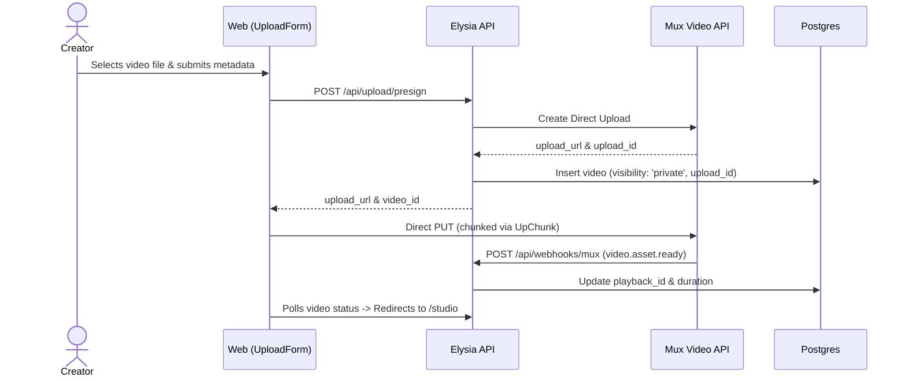

# DESIGN.md — iTube Design Tokens & System Architecture

This document formalizes the design language, token system, component primitives, and responsive layout hierarchy for the iTube platform.

---

## 1. System Architecture Diagram

```mermaid
graph TD
    subgraph Client [Web Application (Next.js 15 + React 19)]
        Masthead[56px Fixed Masthead]
        Drawer[240px / 72px Guide Drawer]
        Feed[Infinite Video Grid]
        Player[HLS Video Player + Controls]
        Comments[SSE Real-Time Comments]
        Studio[Creator Studio Dashboard]
        Upload[Direct-to-Mux UpChunk]
    end

    subgraph API [API Tier (Elysia on Bun)]
        Treaty[Eden Treaty Type-Safe RPC]
        AuthGuard[Clerk JWT & Scoped Ownership]
        SearchEngine[tsvector / pg_trgm Engine]
        CommentBus[BroadcastChannel SSE Fan-out]
        ViewService[Debounced View Count Lock]
        Cron[Scheduling Sweeper & Rollup]
    end

    subgraph Infrastructure [Data & Storage Tier]
        Postgres[(PostgreSQL 18 - Drizzle ORM)]
        Redis[(Upstash Redis - Feeds & Cooldowns)]
        QStash[(Upstash QStash - Scheduler)]
        Mux[(Mux Video Processing & CDN)]
    end

    Masthead --> Treaty
    Drawer --> Treaty
    Feed --> Treaty
    Player --> Treaty
    Comments --> Treaty
    Studio --> Treaty
    Upload --> Mux

    Treaty --> AuthGuard
    AuthGuard --> SearchEngine
    AuthGuard --> CommentBus
    AuthGuard --> ViewService

    SearchEngine --> Postgres
    CommentBus --> Redis
    ViewService --> Redis
    ViewService --> Postgres
    Cron --> Postgres
    Cron --> QStash
    API --> Mux
```

---

## 2. YouTube Color Tokens

Authentic YouTube Dark Theme palette extracted from web production CSS:

| Token Name | Value | Purpose |
| :--- | :--- | :--- |
| `--yt-bg-base` | `#0f0f0f` | Main viewport and feed canvas background |
| `--yt-bg-surface` | `#212121` | Pill chips, cards, and modal container backgrounds |
| `--yt-bg-elevated` | `#3d3d3d` | Hover states, active borders, and dropdown items |
| `--yt-text-primary` | `#f1f1f1` | Headings, video titles, and primary body text |
| `--yt-text-secondary` | `#aaaaaa` | Channel handles, view counts, and timestamps |
| `--yt-accent-red` | `#ff0000` | Brand logo mark, active video scrubber, live badges |
| `--yt-accent-blue` | `#3ea6ff` | Action links, primary interactive buttons, verified checkmarks |

---

## 3. Layout Hierarchy & Sizing Specs

- **Masthead Height:** `56px` fixed header (`--yt-masthead-height`)
- **Guide Drawer:**
  - Expanded: `240px` (`--yt-drawer-width`)
  - Mini / Collapsed: `72px` (`--yt-drawer-mini-width`)
- **Video Card Aspect Ratio:** `16:9` (`aspect-video`)
- **Grid Layout:**
  - Mobile (`< 640px`): `1 column`
  - Tablet (`640px - 1024px`): `2 columns`
  - Desktop (`1024px - 1280px`): `3 columns`
  - Ultrawide (`> 1280px`): `4 columns`

---

## 4. Key Component Workflows

### 4.1 Video Upload & Ingestion


### 4.2 View Counting & Redis Debounce
1. Client plays video and sends heartbeat every 10s (`POST /api/videos/:id/view`).
2. Server verifies 30-second playback threshold (or 50% for clips <30s).
3. Server executes atomic Redis `SET view_cooldown:{videoId}:{viewerId} 1 EX 7200 NX`.
4. If key was newly set: increment `video_views_buffer:{videoId}` and track video ID in Redis set `dirty_video_views`.
5. Background worker flushes accumulated buffer every 60s directly into PostgreSQL.
