# iTube — Modern Full-Stack YouTube Clone Monorepo

[](https://github.com/param/iTube/actions/workflows/ci.yml)
[](https://bun.sh)
[](https://nextjs.org)
[](https://elysiajs.com)
[](https://tailwindcss.com)

A pixel-accurate YouTube clone built on Bun workspaces, Next.js 15 App Router, Elysia, Drizzle ORM + Postgres, Upstash Redis, Clerk auth, and Mux Video streaming.

---

## 📽️ Visual Previews

### Home Feed & Collapsible Drawer


### Instant Search & Autocomplete


---

## 🏗️ Architecture Overview

```mermaid
graph LR
    subgraph Frontend [Next.js 15 Web]
        A[Masthead 56px]
        B[GuideDrawer]
        C[Category Carousel]
        D[Player Controls]
        E[SSE Comments]
        F[Creator Studio]
    end

    subgraph Backend [Elysia on Bun]
        G[Eden Treaty RPC]
        H[Clerk JWT Auth]
        I[Mux Ingestion]
        J[View Debounce]
        K[Broadcast SSE]
    end

    subgraph Storage [Datastores & CDN]
        L[(Postgres 18)]
        M[(Upstash Redis)]
        N[(Mux Video)]
    end

    Frontend -->|Typed RPC| Backend
    Backend --> Storage
```



---

## ✨ Features Checklist

- [x] **Monorepo Topology**: Bun workspaces (`apps/web`, `apps/api`, `packages/db`, `packages/ui`, `packages/types`, `packages/config`).
- [x] **Relational Schema**: 10 Drizzle tables with CUID2 primary keys, cascade rules, and compound indexes.
- [x] **Full-Text Search**: PostgreSQL `tsvector` generated column with GIN index and `websearch_to_tsquery`.
- [x] **Debounced Autocomplete**: 150ms client debounce backed by Redis `search_suggest` caching (TTL: 1 hour).
- [x] **View Counting & Cooldowns**: 30s playback threshold qualification with 2-hour NX cooldown locks and 60s background batch flush.
- [x] **Category Feed Caching**: Keyset cursor pagination with Redis page-1 caching (TTL: 300s).
- [x] **Real-Time Comments**: Server-Sent Events (SSE) broadcast fan-out via `BroadcastChannel` with depth-1 reply invariant.
- [x] **Video Streaming**: HLS playback with custom red-accent scrubber, theater mode toggle, and keyboard shortcuts (`space`, `k`, `m`, `f`, `t`).
- [x] **Creator Studio**: Video upload with chunked progress tracking via Mux presigned URLs, 7d/28d analytics rollup, and inline metadata edit modal.
- [x] **Subscriptions**: Optimistic subscription button toggle and denormalized subscriber counter.
- [x] **End-to-End Testing**: Headless Playwright automated suite with captured screenshots, videos, and GIF demonstrations.

---

## 🚀 Getting Started

### Prerequisites
- [Bun](https://bun.sh) `>=1.4.0`
- [Node.js](https://nodejs.org) (Latest / v26+)

### Installation
```bash
# Clone the repository
git clone https://github.com/param/iTube.git
cd iTube

# Install all workspace dependencies
bun install
```

### Environment Setup
Copy the example environment variables:
```bash
cp .env.example .env
```
Ensure `DATABASE_URL`, `CLERK_SECRET_KEY`, `MUX_TOKEN_ID`, `MUX_TOKEN_SECRET`, and `UPSTASH_REDIS_REST_URL` are configured.

### Database Migrations
```bash
cd packages/db
bun run db:generate
bun run db:migrate
```

### Development
Start all apps and packages concurrently:
```bash
bun run dev
```
- Web Application: [http://localhost:3000](http://localhost:3000)
- Elysia API Server: [http://localhost:3001](http://localhost:3001)

### Quality & Testing
```bash
# Run Biome lint and format checks
bun run check

# Run unit and integration tests across all packages
bun run test

# Run Playwright E2E test harness
bun x playwright test
```

---

## 📂 Monorepo Topology

```
iTube/
├── apps/
│   ├── api/        # Elysia server on Bun (port 3001)
│   └── web/        # Next.js 15 App Router web client (port 3000)
├── packages/
│   ├── config/     # Biome and TypeScript base configurations
│   ├── db/         # Drizzle schemas, migrations, and database client
│   ├── types/      # Shared Zod DTO contracts and codecs
│   └── ui/         # YouTube tokens, Tailwind preset, and Shadcn primitives
├── e2e/            # Playwright end-to-end test suite
├── e2e-evidence/   # Recorded screenshots, video captures, and animated GIFs
└── .agents/        # Project-local verification skills and feature map
```
